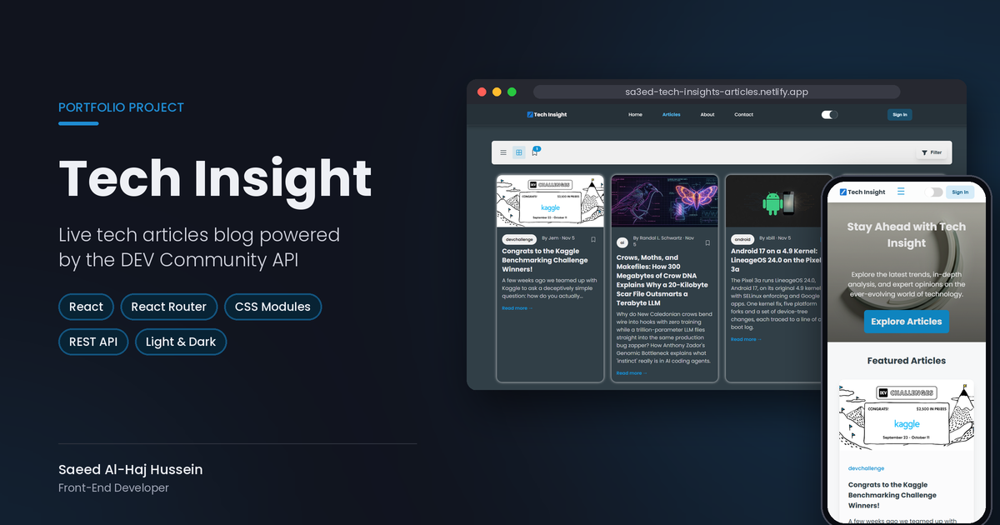

# Tech Insight – Tech Articles Blog

[](https://sa3ed-tech-insights-articles.netlify.app/)

Tech Insight is a responsive tech blog built with React. It loads real, up-to-date articles from the [DEV Community API](https://developers.forem.com/api) and lets you browse them in list or grid view, filter them by topic, bookmark the ones you like, and read each one on its own page with related articles.



## Features

- **Live articles** from the DEV Community API
- **List and grid views** for the articles page
- **Bookmarks with a counter**, saved in the browser
- **Filters** by topic/tag
- **Pagination** to move through the articles
- **Article page** with the full content, cover image, author info, a link to the original post, and **related articles**
- **Light/dark mode**, remembered between visits
- **Responsive** layout for mobile, tablet and desktop

## Tech Stack

- [React](https://react.dev/) 19
- [React Router](https://reactrouter.com/) 7
- [Vite](https://vite.dev/) 7
- CSS Modules for styling
- [Poppins](https://fontsource.org/fonts/poppins) via `@fontsource/poppins`
- [DEV Community (Forem) API](https://developers.forem.com/api)
- Deployed on [Netlify](https://www.netlify.com/)

## Getting Started

```bash
npm install
npm run dev      # start the dev server
npm run build    # build for production into dist/
npm run preview  # preview the production build
```

## Content & Attribution

All article content (text, images and code) belongs to its original authors on [DEV](https://dev.to/). This project only displays it through the public DEV Community API. Every article page shows the author's name, links to their DEV profile, and has an **"Originally published on DEV"** link to the original post.

## Author

**Saeed Al-Haj Hussein**

- Portfolio: [sa3ed-031.github.io](https://sa3ed-031.github.io)
- LinkedIn: [sa3ed-al-haj-hussein](https://www.linkedin.com/in/sa3ed-al-haj-hussein)
- GitHub: [Sa3ed-031](https://github.com/Sa3ed-031)
